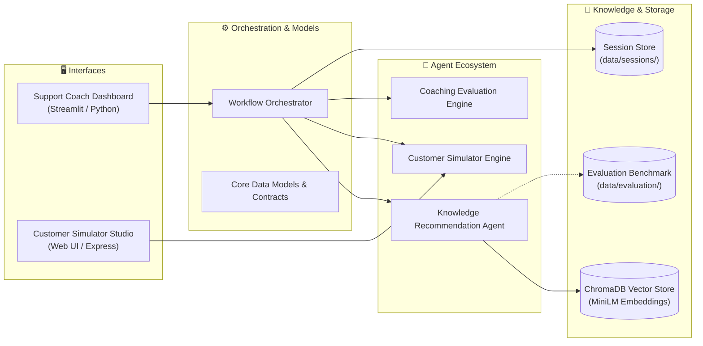

# 🎧 AI Customer Support Coaching Assistant

[](https://www.python.org/)
[](tests/)
[](frontend/)
[](https://www.trychroma.com/)
[](LICENSE)

> A modern multi-agent platform designed to train, evaluate, and coach frontline customer support representatives using affective dialogue simulation, automated quality evaluation, and policy-grounded dense retrieval.

---

## 🌟 Overview

The **AI Customer Support Coaching Assistant** integrates generative customer simulation with policy retrieval-augmented generation (RAG) and automated coaching:

- **Support Coach Dashboard (Python / Streamlit)**: Interactive workspace for trainees and supervisors featuring session configuration, turn-by-turn coaching tips, interactive system topology, and semantic policy search.
- **Customer Simulator Agent (Node.js / Express)**: Affective customer dialogue engine featuring continuous emotional state progression (frustration, trust, satisfaction, arousal), realistic personas, scenario ladders, and dynamic disclosure.

---

## 🏗️ Architecture & Component Topology



### Core Components

| Component | Module | Responsibility |
|:---|:---|:---|
| **Workflow Orchestrator** | `backend/orchestrator/` | Coordinates session lifecycle, error resilience, and typed contract boundaries. |
| **Knowledge Recommendation Agent** | `backend/agents/` | Context-aware dense semantic retrieval over support policies using ChromaDB. |
| **Customer Simulator Agent** | `src/`, `public/` | Generates realistic customer turns with persona constraints and emotional progression. |
| **Coaching Evaluation Engine** | `backend/services/` | Scores trainee turns on empathy, conciseness, calm formatting, and actionable steps. |
| **Support Knowledge Base RAG** | `backend/services/rag_stub.py` | Sliding-window PDF chunking and vector indexing powered by `all-MiniLM-L6-v2`. |
| **Retrieval Evaluation Framework** | `backend/evaluation/` | Automated IR benchmarking suite (Recall@K, Precision@K, MRR, NDCG@K, no-match F1). |
| **Streamlit Coaching Dashboard** | `frontend/` | Multi-view coaching interface, saved session inspector, and interactive architecture. |

---

## 📂 Directory Structure

```text
customer-support-coach/
├── backend/            # Backend services, agents, evaluation & orchestration
│   ├── agents/         # Knowledge Recommendation Agent implementation
│   ├── core/           # Shared domain schemas (Session, AgentResult, InteractionMode)
│   ├── evaluation/     # Retrieval metric suite and benchmark test runner
│   ├── orchestrator/   # Central workflow coordinator, schemas & test doubles
│   └── services/       # ChromaDB vector store, document ingestion & persistence
├── frontend/           # Streamlit web application, dashboard views & glass theme
├── data/               # Persistent data: ChromaDB vector index, sessions & sample PDFs
├── docs/               # Technical architecture, design rationale & evaluation studies
├── src/                # Customer Simulator Express.js service & emotional engine
├── public/             # Customer Simulator browser UI
├── scripts/            # CLI demonstration runner and smoke test verification
└── tests/              # Pytest automated test suites (89 passing tests)
```

---

## 🚀 Quickstart

### Python Backend & Dashboard

```bash
# 1. Clone repository
git clone https://github.com/spoortibiradar8/customer-support-coach.git
cd customer-support-coach

# 2. Set up virtual environment
python -m venv venv
# Windows (PowerShell):
.\venv\Scripts\Activate.ps1
# macOS/Linux:
source venv/bin/activate

# 3. Install dependencies
pip install -r requirements.txt

# 4. Launch Streamlit Coaching Dashboard
streamlit run frontend/app.py
```
*Access the dashboard in your browser at `http://localhost:8501`.*

---

### Node.js Customer Simulator (Optional)

```bash
# Install dependencies and start server
npm install
npm start
```
*Access the Customer Simulator Web Studio at `http://localhost:3000`.*

---

## 🧪 Testing & Verification

The project includes an automated test suite with **89 tests** verifying contract schemas, contextual query synthesis, metadata propagation, and live RAG retrieval:

```bash
# Run all tests
python -m pytest -v

# Run smoke tests
python scripts/smoke_test.py

# Run standalone CLI demo
python scripts/run_demo.py
```

---

## 📊 Knowledge Retrieval Benchmark

An automated retrieval evaluation framework measures policy grounding against 22 labeled customer support queries ($K=3$):

```bash
python -m backend.evaluation.eval_runner
```

| Metric Category | Metric | Score | Benchmark Interpretation |
|:---|:---|:---:|:---|
| **Information Retrieval**<br>*(Answerable Queries, N=14)* | **Recall@3 (Doc-level)** | **100.00%** | All target policy documents retrieved |
| | **Recall@3 (Chunk-level)** | **100.00%** | All relevant policy chunks retrieved |
| | **Precision@3 (Doc-level)** | **33.33%** | 1 relevant document out of top-3 cutoff |
| | **Mean Reciprocal Rank (MRR)** | **1.0000** | Ground-truth policy placed at **Rank 1** across all queries |
| | **NDCG@3** | **1.0000** | Ideal discounted cumulative gain ranking |
| | **Source Attribution Acc.** | **100.00%** | Top-1 result correctly attributes ground-truth doc |
| **No-Match Classification**<br>*(Unanswerable Queries, N=8)* | **Out-of-Domain Rejection** | **100.00%** | Rejects out-of-domain queries ($s \le 0.07$) |
| | **No-Match Precision** | **100.00%** | Zero false rejections of answerable queries |
| | **No-Match Recall** | **50.00%** | Accurately catches unanswerable policy questions |
| | **No-Match F1-Score** | **66.67%** | Balanced classification accuracy |
| **Retrieval Latency** | **Median (p50)** | **17.9 ms** | Fast local CPU semantic search |
| | **95th Percentile (p95)** | **24.2 ms** | Bounded latency under load |

*For root-cause analysis and bi-encoder boundary studies, see [`docs/evaluation_error_analysis.md`](docs/evaluation_error_analysis.md).*

---

## 📚 Technical Documentation

- **[System Architecture](docs/architecture.md)**: Multi-agent topology, data flow, and shared data models.
- **[Design Decisions](docs/design_decisions.md)**: Justifications for local embeddings, chunking strategy, and storage.
- **[Orchestrator Integration](docs/orchestrator_integration.md)**: Workflow request/response signatures and integration examples.
- **[Knowledge Agent Contracts](docs/knowledge_agent_integration_readiness.md)**: Strict Pydantic v2 schemas and integration guidelines.
- **[Retrieval Benchmark Report](docs/knowledge_retrieval_evaluation_report.md)**: Comprehensive empirical evaluation results.

---

## 📄 License

This project is licensed under the MIT License.
