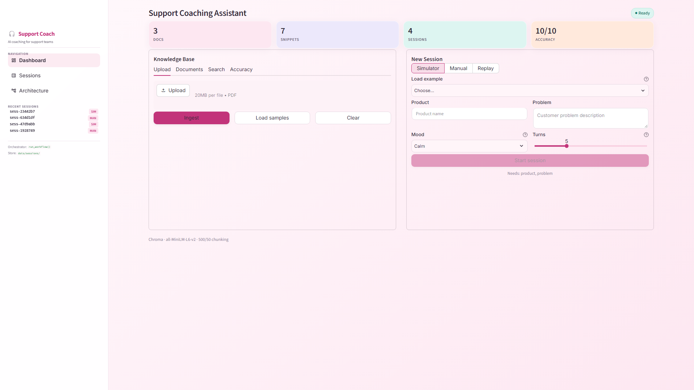
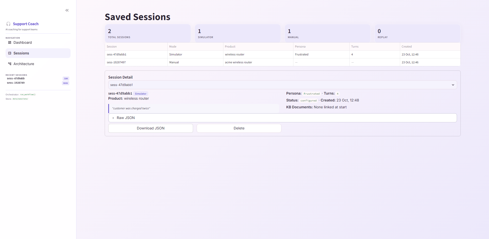
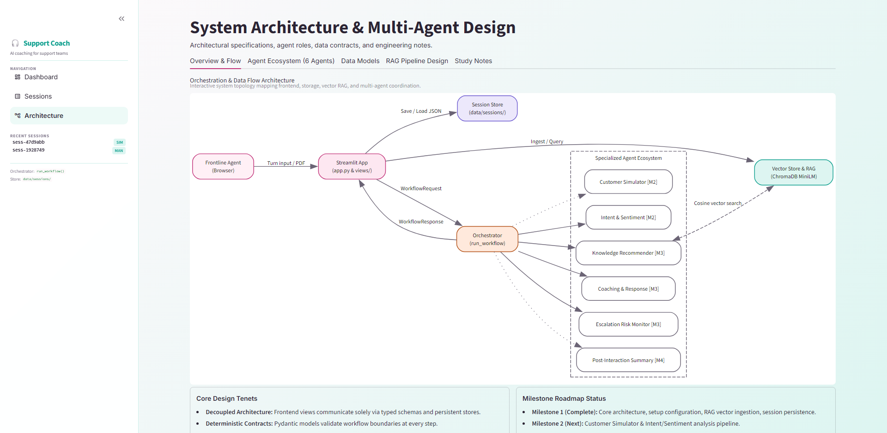

# AI Customer Support Coaching Assistant — Milestone 1

An AI-powered coaching and practice assistant for frontline customer support teams.

Milestone 1 delivers the foundational architecture, persistent session configuration, and local offline Retrieval-Augmented Generation (RAG) knowledge base indexing.

---

## Application Screenshots (1080p, 100% Zoom)

### 1. Dashboard View (Single-Screen Fit)

*Compact 4-metric stat cards, tabbed Support Knowledge Base (Upload, Documents, Test Retrieval, Quality), and Session Setup with scenario presets, live character counters, and readiness checklist.*

### 2. Sessions Management View

*Directory of all saved sessions sorted newest first, readable two-column summary card with scenario quote blocks, and export actions (Download JSON and safe delete with confirmation).*

### 3. Architecture & Multi-Agent Design View

*Interactive Graphviz flow topology, 6-agent milestone matrix (M2/M3/M4), domain models inspected via `inspect.getsource`, and dedicated study notes & engineering decision tabs.*

---

## Knowledge Base & Dense Retrieval Benchmark

The RAG pipeline operates locally using **SentenceTransformers (`all-MiniLM-L6-v2`)** and a persistent **ChromaDB (`PersistentClient`)** vector store with cosine distance.

### Sample Document Ingestion
| Document Name | File Size | Characters | Pages | Chunks Indexed | Explanation |
| :--- | :--- | :--- | :--- | :--- | :--- |
| `account_and_password_faq.pdf` | 13.9 KB | 903 | 2 | **3 chunks** | Page 1 (515 chars) yields 2 chunks (0–500, 450–515); Page 2 (388 chars) yields 1 chunk. |
| `returns_and_refunds.pdf` | 13.5 KB | 644 | 1 | **2 chunks** | Total text is 644 chars; 500-char window with 50-char overlap yields 2 chunks ($450 + 194 = 644$). |
| `shipping_and_delivery.pdf` | 13.8 KB | 775 | 2 | **2 chunks** | Page 1 has 390 chars, Page 2 has 385 chars. Both are $<500$ chars, producing 1 chunk per page. |
| **Total Knowledge Base** | — | **2,322** | **5** | **7 chunks** | **100% Deduplicated (deterministic SHA-256 chunk IDs)** |

### Ground-Truth Retrieval Benchmark
Retrieval evaluation is automated via `evaluate_retrieval(k=3)` using `data/evaluation/retrieval_eval.json`:
- **Total Ground-Truth Queries:** 10
- **Hit@1 Accuracy:** **10/10 (100.0%)** (correct document ranked #1 for every query)
- **Hit@3 Accuracy:** **10/10 (100.0%)** (exceeds the $\ge 80\%$ target)
- **Total Misses:** **0**

---

## Features (Milestone 1)

- **Single-Screen Fit:** Optimized at 100% zoom on 1920×1080 (usable height ~940px). Stat cards, Knowledge Base card, Session Setup card, and the Start button fit without vertical scrolling.
- **Per-Page Theming:** Active sidebar pill, selectbox backgrounds, expanders, and table headers dynamically adopt the current page's pastel palette:
  - **Dashboard:** Rose (`#C2347A`, tint `#FDE7F1`)
  - **Sessions:** Lavender (`#6D5BD0`, tint `#ECE8FB` — zero pink)
  - **Architecture:** Mint (`#0E9F8E`, tint `#DDF5F1`)
- **Knowledge Base Tabs:**
  - **Upload:** Multi-PDF uploader, 20 MB size guard, scanned PDF text validation, Ingest & Clear buttons.
  - **Documents:** Tabular view of indexed documents (File, Pages, Chunks) and live chunk preview.
  - **Test Retrieval:** Keyword search with doc name/page badges, visual cosine score bar, and highlighted keywords.
  - **Quality:** One-click evaluation suite displaying Queries, Hit@1 rate, Hit@3 rate, and misses table.
- **Session Setup & Flat Schema:**
  - **Preset Scenarios:** "Load example" selectbox with 3 preset customer issues matching bundled policy documents.
  - **Live Character Counters:** Real-time character counts under Product Context ($x/100$) and Customer Scenario ($x/500$).
  - **Replay Preview:** Renders uploaded transcripts as native chat bubbles with message count verification.
  - **Readiness Checklist:** Live checks (KB chunks $\ge 1$, Product valid, Scenario valid, Mode valid) with visual green ticks.
  - **Post-Start Success Card:** Summary card with direct "Download Session JSON" button and toast notification.
- **Tolerant Schema Migration:** Backward-compatible normalization converts legacy nested session JSON files into the new flat schema on read.

---

## Setup & Installation

### Prerequisites
- Python 3.11, 3.12, 3.13, or 3.14
- Recommended: Virtual environment (`venv`)

### 1. Clone & Setup Virtual Environment
```bash
git clone https://github.com/spoortibiradar8/customer-support-coach.git
cd customer-support-coach

python -m venv .venv
# Windows:
.venv\Scripts\activate
# Linux/macOS:
# source .venv/bin/activate
```

### 2. Install Dependencies
```bash
pip install -r requirements.txt
```

---

## How to Run the Application

Start the Streamlit application on port 8502:

```bash
streamlit run frontend/app.py --server.port 8502
```

Navigate to **http://localhost:8502** in your browser.

---

## Running Automated Tests

Run pytest across all unit tests and milestone verification suites:

```bash
# Run Milestone 1 tests (includes deduplication, RAG retrieval, migration, and Hit@3 >= 80%)
python -m pytest tests/test_m1.py -v

# Run orchestrator contract tests
python -m pytest tests/test_orchestrator.py -v

# Run end-to-end smoke test
python smoke_test.py
```
