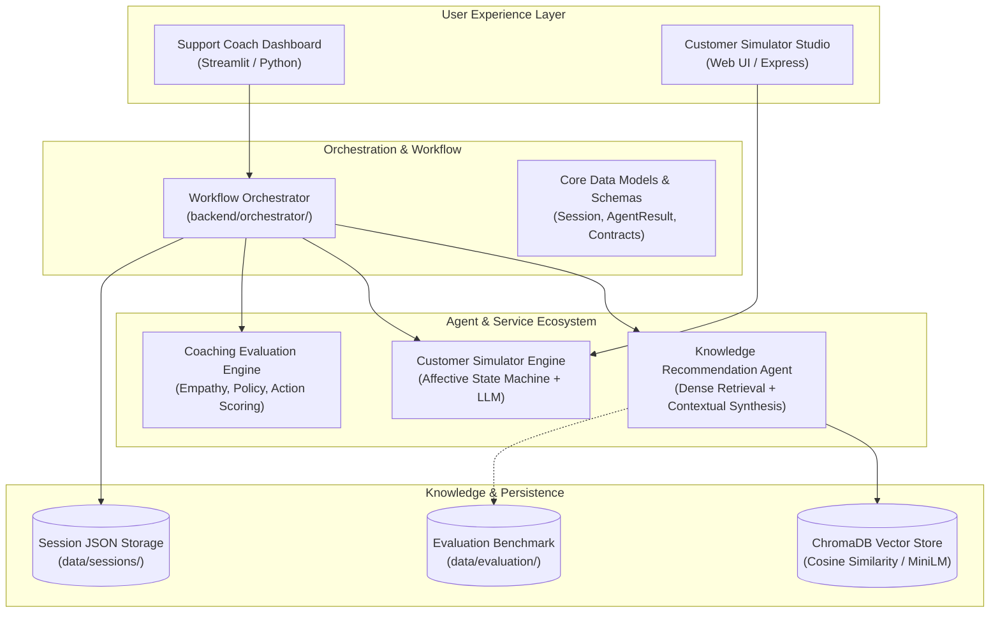

# 🎧 AI Customer Support Coaching Assistant

> An enterprise-grade, multi-agent platform designed to train, evaluate, and coach frontline customer support representatives using realistic dialogue simulation, automated quality evaluation, and policy-grounded retrieval.

---

## 🌟 Overview

The **AI Customer Support Coaching Assistant** combines generative affective dialogue simulation with policy retrieval-augmented generation (RAG) and structured coaching.

The platform provides two complementary interfaces:
1. **Support Coach Dashboard (Python / Streamlit)**: Interactive workspace for trainees and supervisors, featuring session management, interactive architecture flows, live document ingestion, and policy knowledge retrieval.
2. **Customer Simulator Agent (Node.js / Express)**: Affective customer dialogue engine featuring continuous emotional progression (frustration, trust, satisfaction, arousal), realistic personas, scenario constraints, and turn-by-turn dialogue generation.

---

## 🏗️ Architecture & Component Topology



### Core Components
- **Workflow Orchestrator (`backend/orchestrator/`)**: Coordinates session state, trainee message processing, agent invocations, and error handling.
- **Knowledge Recommendation Agent (`backend/agents/`, `backend/services/`)**: Synthesizes customer messages, detected intents, and conversation history to retrieve accurate policy passages from local vector storage.
- **Support Knowledge Base RAG (`backend/services/rag_stub.py`)**: Vector indexing and dense semantic retrieval engine powered by `all-MiniLM-L6-v2` and ChromaDB.
- **Retrieval Evaluation Framework (`backend/evaluation/`)**: Automated benchmarking suite calculating Recall@K, Precision@K, MRR, NDCG@K, no-match F1, and latency across labeled evaluation datasets.
- **Customer Simulator Agent (`src/`, `public/`)**: Node.js/Express service simulating customer behaviors with configurable patience, emotional sensitivity, technical literacy, and progressive information disclosure.
- **Streamlit Web Application (`frontend/`)**: Modern dashboard for running simulated practice sessions, viewing saved sessions, inspecting architecture diagrams, and testing knowledge retrieval.

---

## 📂 Directory Structure

```text
customer-support-coach/
├── .streamlit/                     # Streamlit server and theme configuration
│   └── config.toml
├── backend/
│   ├── agents/                     # Agent implementations
│   │   ├── __init__.py
│   │   └── knowledge_agent.py      # Knowledge Recommendation Agent
│   ├── core/                       # Shared data models and type definitions
│   │   ├── __init__.py
│   │   └── data_models.py
│   ├── evaluation/                 # Retrieval evaluation framework
│   │   ├── __init__.py
│   │   ├── eval_metrics.py         # Pure IR and classification metric implementations
│   │   └── eval_runner.py          # Benchmark test harness and reporter
│   ├── orchestrator/               # Workflow orchestration and schemas
│   │   ├── __init__.py
│   │   ├── knowledge_schemas.py    # Pydantic v2 knowledge contracts
│   │   ├── mock_components.py
│   │   ├── orchestrator.py
│   │   └── schemas.py
│   ├── services/                   # Storage, validation, and retrieval services
│   │   ├── __init__.py
│   │   ├── knowledge_agent.py      # Backward-compatible agent re-export
│   │   ├── pipeline_stub.py
│   │   ├── rag_stub.py             # ChromaDB vector store and PDF ingestion
│   │   ├── storage.py              # Session persistence service
│   │   └── validation.py
│   ├── config.py                   # Centralized repository path configuration
│   └── requirements.txt
├── data/
│   ├── chroma/                     # Local ChromaDB persistent vector database
│   ├── evaluation/                 # Labeled evaluation datasets and results
│   │   ├── agent_eval_dataset.json # Ground-truth customer queries (22 test cases)
│   │   └── agent_eval_results.json # Empirical evaluation outputs
│   ├── sample_pdfs/                # Sample support policy documents
│   │   ├── account_and_password_faq.pdf
│   │   ├── returns_and_refunds.pdf
│   │   └── shipping_and_delivery.pdf
│   └── sessions/                   # Saved coaching session records
├── docs/                           # Technical documentation and architecture
│   ├── screenshots/                # Application UI screenshots
│   ├── architecture.md             # System architecture design
│   ├── design_decisions.md         # Key engineering design choices
│   ├── evaluation_error_analysis.md # Evaluation error analysis and root cause study
│   ├── knowledge_agent_integration_readiness.md # Agent integration guide
│   ├── knowledge_retrieval_evaluation_report.md  # Comprehensive evaluation report
│   ├── orchestrator_integration.md # Orchestrator integration guide
│   └── study_notes.md
├── frontend/                       # Streamlit web application
│   ├── styles/                     # CSS themes and custom styling
│   ├── views/                      # Dashboard views (setup, sessions, architecture)
│   ├── app.py                      # Streamlit application entry point
│   └── theme.py
├── public/                         # Customer Simulator web client (HTML/CSS/JS)
├── scripts/                        # Utility scripts and visual QA tools
│   ├── run_demo.py                 # CLI demonstration runner
│   └── smoke_test.py               # Quick sanity test script
├── src/                            # Customer Simulator Express.js engine
│   ├── data/                       # Simulator personas and scenario definitions
│   ├── engines/                    # Affective, evaluation, and heuristic engines
│   ├── batchRunner.js              # Simulation benchmark runner
│   ├── cli.js                      # Simulator CLI interface
│   ├── server.js                   # Simulator REST API server
│   └── simulator.js                # CustomerSimulatorAgent class
├── tests/                          # Automated pytest test suites (89 tests)
│   ├── test_contextual_query.py    # Query builder and clue synthesis tests
│   ├── test_evaluation_metrics.py  # Unit tests for retrieval metrics
│   ├── test_knowledge_contract.py  # Schema validation and serialization tests
│   ├── test_live_rag_integration.py # Live ChromaDB integration tests
│   ├── test_m1.py                  # Baseline ingestion and session tests
│   ├── test_orchestrator.py        # Orchestration workflow tests
│   └── test_retrieval_metadata.py  # Chunk ID extraction and propagation tests
├── .env.example                    # Template environment variables
├── .gitignore                      # Git exclusion rules
├── package.json                    # Node.js dependencies for Customer Simulator
├── package-lock.json
├── pyproject.toml                  # Python package metadata
├── pytest.ini                      # Pytest runner configuration
└── requirements.txt                # Unified Python requirements
```

---

## 🚀 Getting Started

### Prerequisites
- **Python**: Version 3.10+ (tested up to Python 3.14)
- **Node.js**: Version 18+ (optional, for Customer Simulator server)

---

### Python Environment Setup

1. **Clone the repository:**
   ```bash
   git clone https://github.com/spoortibiradar8/customer-support-coach.git
   cd customer-support-coach
   ```

2. **Create and activate a virtual environment:**
   ```bash
   python -m venv venv
   # Windows (PowerShell):
   .\venv\Scripts\Activate.ps1
   # macOS/Linux:
   source venv/bin/activate
   ```

3. **Install dependencies:**
   ```bash
   pip install -r requirements.txt
   ```

4. **Launch the Streamlit Dashboard:**
   ```bash
   streamlit run frontend/app.py
   ```
   Open your browser to `http://localhost:8501`.

---

### Node.js Customer Simulator Setup (Optional)

1. **Install Node dependencies:**
   ```bash
   npm install
   ```

2. **Start the Simulator Server:**
   ```bash
   npm start
   ```
   The simulator API and web studio will be accessible at `http://localhost:3000`.

3. **Run Simulator CLI or Benchmark:**
   ```bash
   npm run cli
   npm run benchmark
   ```

---

## 🧪 Testing and Verification

The repository includes a comprehensive automated test suite with **89 tests** covering unit logic, Pydantic contracts, contextual queries, metadata propagation, and live RAG retrieval:

```bash
# Run the complete test suite
python -m pytest -v

# Run specific component test suites
python -m pytest tests/test_evaluation_metrics.py -v
python -m pytest tests/test_knowledge_contract.py -v
python -m pytest tests/test_contextual_query.py -v
python -m pytest tests/test_retrieval_metadata.py -v
python -m pytest tests/test_live_rag_integration.py -v
python -m pytest tests/test_orchestrator.py -v
```

---

## 📊 Knowledge Retrieval Benchmark & Evaluation

The platform includes an automated retrieval evaluation framework grounded in real customer support policies.

### Running the Live Benchmark
```bash
python -m backend.evaluation.eval_runner
```

### Benchmark Summary (22 Labeled Queries, k=3)

| Metric Category | Metric | Score | Interpretation |
|---|---|---|---|
| **Information Retrieval** (Answerable Queries, N=14) | **Recall@3 (Doc-level)** | **100.00%** | All target policy documents retrieved |
| | **Recall@3 (Chunk-level)** | **100.00%** | All target policy chunks retrieved |
| | **Precision@3 (Doc-level)** | **33.33%** | 1 relevant document out of top-3 cutoff |
| | **Mean Reciprocal Rank (MRR)** | **1.0000** | Target document placed at **Rank 1** for 100% of answerable queries |
| | **NDCG@3** | **1.0000** | Ideal discounted cumulative gain ranking |
| | **Source Attribution Accuracy** | **100.00%** | Top-1 result correctly attributes ground-truth doc |
| **No-Match Classification** (Unanswerable Queries, N=8) | **Out-of-Domain Rejection** | **100.00%** | Cleanly rejects unrelated queries (scores $\le 0.07$) |
| | **No-Match Precision** | **100.00%** | Zero false rejections of answerable queries |
| | **No-Match Recall** | **50.00%** | Identifies 4/8 unanswerable queries |
| | **No-Match F1-Score** | **66.67%** | Balanced classification accuracy |
| **Retrieval Latency** | **Median (p50)** | **39.1 ms** | Fast local CPU semantic retrieval |
| | **95th Percentile (p95)** | **61.3 ms** | Bounded latency under load |

For a complete analysis of false negatives and bi-encoder boundaries, refer to [`docs/evaluation_error_analysis.md`](docs/evaluation_error_analysis.md).

---

## 🤝 Integration & Contributing

- **Orchestrator Integration**: Consult [`docs/orchestrator_integration.md`](docs/orchestrator_integration.md) for request/response dataclasses and workflow handlers.
- **Knowledge Agent Contract**: Consult [`docs/knowledge_agent_integration_readiness.md`](docs/knowledge_agent_integration_readiness.md) for typed Pydantic v2 invocation guidelines.
- **Architecture & Technical Decisions**: Review [`docs/architecture.md`](docs/architecture.md) and [`docs/design_decisions.md`](docs/design_decisions.md).

---

## 📄 License

This project is licensed under the MIT License.
