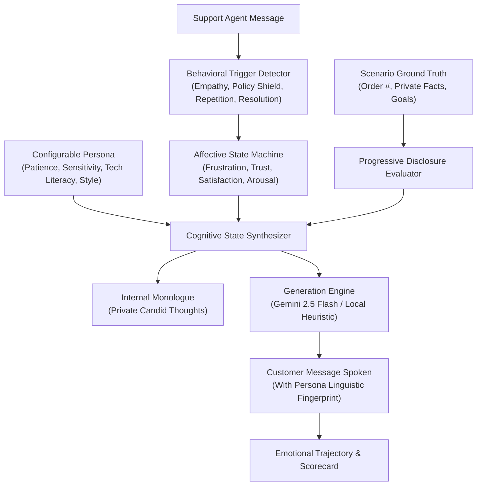

# 🤖 Customer Simulator Agent (CSA)

> An Affective Dialogue Simulator that generates realistic, scenario-consistent customer messages turn-by-turn with configurable personas and dynamic emotional progression.

---

## 🌟 Overview

The **Customer Simulator Agent (CSA)** is designed for training customer service teams, evaluating LLM support bots, benchmarking conversational policies, and conducting realistic red-teaming.

Unlike static prompt templates, CSA features a **continuous affective state machine** where customer emotions (frustration, trust, satisfaction, arousal) evolve dynamically based on the support agent's actions, conversational empathy, procedural friction, and patience decay.

---

## 🏗️ Core Architectural Pillars



### 1. 👤 Configurable Persona Studio
Each customer persona has parameterized psychological traits and distinct linguistic fingerprints:
- **Patience (1 - 10)**: Rate of frustration acceleration per unresolved turn.
- **Emotional Sensitivity (1 - 10)**: Multiplier for emotional impact from praise, apologies, or dismissive replies.
- **Skepticism (1 - 10)**: Resistance to promises and policy assurances without proof.
- **Tech Literacy (1 - 10)**: Comfort with technical jargon, 2FA, browser debugging, and console errors.
- **Verbosity & Communication Style**: `concise`, `moderate`, `verbose`, or `rambling`; typing speed quirks, capitalization during anger, and specific conversational pet peeves.

#### Built-in Personas:
1. **⚡ Evelyn Reed (Impatient Executive)**: Startup founder, high urgency, demands immediate resolution, zero patience for scripts.
2. **👴 Harold Jenkins (Confused Senior)**: Polite retired teacher, low tech literacy, tells long anecdotes, anxious about security.
3. **💻 Devon Vance (Sarcastic Techie)**: Senior software engineer, catches technical bugs, despises L1 scripts, uses biting sarcasm.
4. **🌸 Maria Santos (Anxious First-Timer)**: Extremely polite, worries about being double-charged, soothed by warmth and empathy.
5. **🔥 Brenda Miller (Escalate-or-Bust / "Karen")**: Volatile, low patience, threatens chargebacks, lawyer action, demands a supervisor immediately.
6. **⚖️ Carlos Ruiz (Pragmatic Bargainer)**: Transactional procurement specialist, negotiates credits and tracks ticket timelines.
7. **Custom Persona Builder**: Interactive UI sliders to configure any persona archetype on the fly.

---

### 2. 📋 Scenario & Ground Truth Engine
Enforces strict conversational consistency:
- **Customer Goal**: The customer's exact objective (e.g., $149 refund, emergency flight rebooking, webhook 502 outage bridge).
- **Ground Truth**: Private facts known to the customer (dates, order numbers, photos, error traces).
- **Progressive Disclosure Rules**: Customer reveals facts only when appropriately asked; if an agent asks for information already supplied, it triggers an immediate **repetition penalty**!
- **Acceptance Criteria & Unacceptable Offers**: Identifies when a deal is acceptable vs when an offer (e.g. store credit only or 14-day delay) causes outrage.

#### Built-in Scenarios:
- **Damaged Luxury Delivery** (E-Commerce)
- **Surprise Renewal Billing Dispute** (Fintech / SaaS)
- **Last Flight Canceled - Stranded Passenger** (Aviation / Travel)
- **Production API 502 Outage** (Developer Tools / B2B)
- **Stolen Phone & 2FA Lockout** (Cybersecurity & Identity)

---

### 3. 🧠 Affective Dynamics & Emotional Progression
The simulator tracks a continuous multi-dimensional affective state:
- **Frustration ($0 - 100\%$)**: Driven by policy shields, repetitive queries, and delay tactics.
- **Trust ($0 - 100\%$)**: Built by active empathy, transparent communication, and fast resolutions.
- **Satisfaction ($0 - 100\%$)**: Driven by goal fulfillment and tangible actions.
- **Arousal / Urgency ($0 - 100\%$)**: Emotional activation level.
- **Primary Affect**: Dynamically updates between `delighted`, `satisfied`, `relieved`, `hopeful`, `impatient`, `frustrated`, `skeptical`, `infuriated`, and `enraged`.
- **Ultimatum Warnings & Rage Quit Dynamics**: When frustration remains $\ge 92\%$ across consecutive turns without resolution, the customer gives a final warning and then walks away.
- **Internal Monologue**: Generates what the customer is candidly thinking in their head vs what they say aloud!

---

### 4. ⚡ Dual-Engine Generation (Local Heuristic + LLM)
- **Local Heuristic Engine (Offline / Zero-Config)**: High-fidelity natural language synthesis engine that works immediately out of the box without requiring any API keys.
- **Google Gemini Engine**: Direct integration with Gemini 2.5 Flash via `@google/genai` or REST API with structured JSON output schema enforcement.
- **OpenAI-Compatible Engine**: Works with OpenAI, Ollama, Groq, or local vLLM instances.

---

### 5. 📊 Objective Evaluation & CSAT Scorecard
At the conclusion of a session, CSA calculates:
- **Predicted CSAT Score (1.0 to 5.0 stars)**
- **First Contact Resolution (FCR)**: Yes / No
- **Empathy Index**: Percentage of turns exhibiting validating language
- **De-escalation Shift**: Frustration delta from peak to final turn
- **Inflection Points**: Turns where the agent made a breakthrough or triggered an escalation
- **Actionable Coaching Feedback**: Strengths and targeted coaching advice

---

## 🚀 Quick Start

### 1. Installation
Requires Node.js 18+ (tested on Node 24).

```bash
# Clone or navigate to the repository
cd project

# Install dependencies
npm install
```

### 2. Launch the Web Studio
Start the server and open your browser at [http://localhost:3000](http://localhost:3000):

```bash
npm start
```

### 3. Run the Interactive Terminal CLI
Test customer simulation directly from your terminal:

```bash
npm run cli
```

### 4. Run the Automated Benchmark
Run automated batch experiments testing different agent strategies against customer personas:

```bash
npm run benchmark
```

### 5. Run the Test Suite
```bash
npm test
```

---

## 💻 REST API Reference

### `GET /api/personas`
Returns available customer personas and their baseline traits.

### `GET /api/scenarios`
Returns available support scenarios, goals, and ground truth data.

### `POST /api/simulator/init`
Initializes a new customer session.
```json
{
  "persona": "impatient_executive",
  "scenario": "damaged_delivery",
  "provider": "local"
}
```

### `POST /api/simulator/turn`
Executes one turn in response to an agent message.
```json
{
  "sessionId": "csa_example",
  "agentMessage": "I am so sorry to hear that! I have processed a full refund to your card."
}
```
**Response:**
```json
{
  "success": true,
  "turnIndex": 1,
  "customerMessage": "Thank you. That is the outcome I expected. Appreciate you getting it processed.",
  "internalMonologue": "Okay, this person is actually taking care of it instead of reading from a script. What a relief.",
  "emotionalState": {
    "frustration": 15,
    "satisfaction": 85,
    "trust": 75,
    "arousal": 30,
    "primary": "delighted",
    "status": "resolved"
  },
  "trajectory": [...]
}
```

### `POST /api/simulator/evaluate`
Generates the end-of-session evaluation scorecard.

### `POST /api/simulator/batch`
Runs an automated batch of agent responses against a customer persona and scenario.

---

## 🔑 Environment Configuration (Optional)

Copy `.env.example` to `.env` to configure LLM keys:

```bash
# Server port
PORT=3000

# Optional: Google Gemini API key
GEMINI_API_KEY=your_gemini_api_key_here

# Optional: OpenAI API key
OPENAI_API_KEY=your_openai_api_key_here
```

*(You can also configure API keys directly inside the Web Studio UI settings dialog without editing `.env` files).*

---

## 📁 Project Structure

```
project/
├── public/                       # Responsive Web Dialogue Studio
│   ├── index.html                # 3-Pane UI Layout
│   ├── style.css                 # Dark theme, gauges & animations
│   └── app.js                    # Dynamic SVG chart, state handling
├── src/
│   ├── data/
│   │   ├── personas.js           # 6 Configurable customer personas
│   │   └── scenarios.js          # 5 Rich support scenarios
│   ├── engines/
│   │   ├── emotionalEngine.js    # Affective state transitions & triggers
│   │   ├── scenarioEngine.js     # Progressive disclosure & goal checks
│   │   ├── heuristicEngine.js    # Local offline generator & monologues
│   │   ├── llmEngine.js          # Gemini 2.5 Flash / OpenAI generator
│   │   └── evaluationEngine.js   # CSAT & coaching scorecard
│   ├── simulator.js              # CustomerSimulatorAgent orchestrator
│   ├── server.js                 # Express REST API & static server
│   ├── cli.js                    # Interactive terminal simulation
│   └── batchRunner.js            # Automated policy benchmark runner
├── test/
│   ├── unit.test.js              # Unit tests for emotional dynamics
│   └── integration.test.js       # REST API integration tests
├── package.json
└── README.md
```

---

## 📄 License
MIT License. Built with ❤️ for realistic affective agent evaluation.

