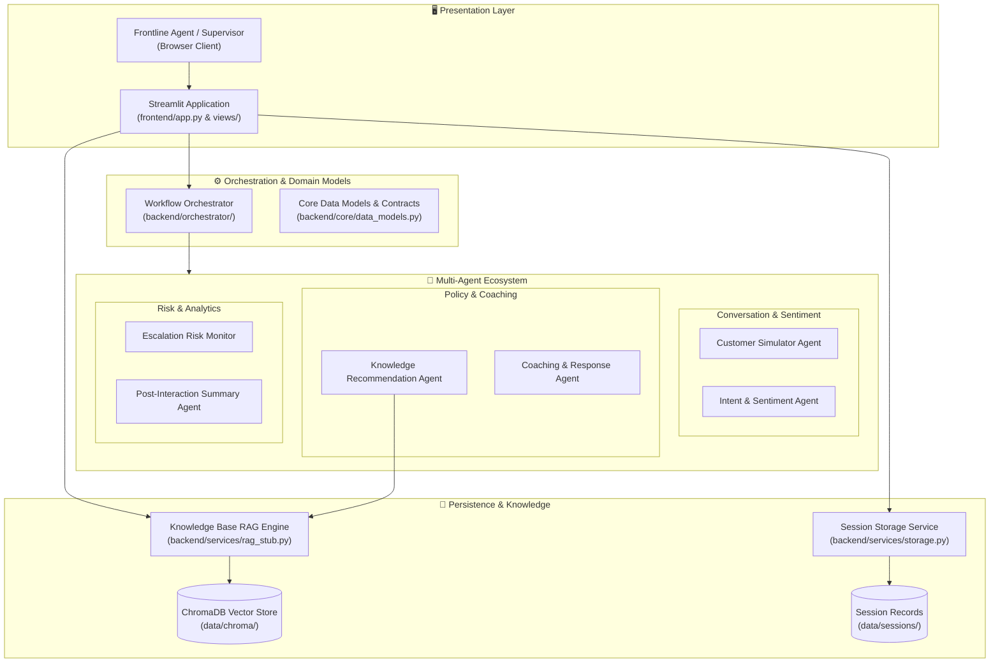

# 🏗️ System Architecture & Engineering Design

> **AI Customer Support Coaching Assistant**  
> An enterprise-grade, multi-agent platform combining generative customer simulation, local vector retrieval-augmented generation (RAG), and real-time coaching for frontline support professionals.

---

## 1. System Topology & Data Flow

---

## 2. Specialized Agent Ecosystem

The platform decomposes support coaching into specialized, modular agents coordinated by the central orchestrator:

| Agent | Responsibility | Input Context | Output Artifact | Functional Role |
|:---|:---|:---|:---|:---|
| **Customer Simulator Agent** | Generates realistic, turn-based dialogue turns driven by persona traits and conversation ladders. | Product context, scenario description, persona, past turns | Simulated customer turn | Dialogue Simulation |
| **Intent & Sentiment Agent** | Classifies customer intent, extracts emotion, and scores frustration (0–100%). | Latest message, dialogue history, product context | Intent category, sentiment tag, frustration score | Real-Time Telemetry |
| **Knowledge Recommendation Agent** | Dense vector search over support documents to retrieve policy citations. | Customer turn, dialogue intent, product context | Top-3 ranked policy passages with source page & score | Policy Grounding |
| **Coaching & Response Agent** | Evaluates agent replies for empathy, conciseness, and action steps. | Trainee draft, recommended policies, intent | Empathy score, clarity notes, recommended reply | Live Coaching |
| **Escalation Risk Monitor** | Tracks customer sentiment trajectories, churn indicators, and SLA threats. | Frustration trend, repeat contact count, keywords | Escalation probability (0–100%), warning flags | Risk Mitigation |
| **Post-Interaction Summary Agent** | Synthesizes full session metrics into resolution quality scores and coaching takeaways. | Complete transcript, turn-by-turn scores, risk telemetry | Overall resolution score (0–100), key strengths & focus areas | Performance Analytics |

---

## 3. Orchestration & Session Lifecycle

The workflow orchestrator (`backend/orchestrator/orchestrator.py`) standardizes request routing and contract enforcement:

1. **Session Configuration:**
   - User configures interaction mode (`Simulator`, `Manual`, `Replay`), product context (3–100 characters), and scenario details (20–500 characters).
   - Mode-specific parameters (Persona traits or historical replay transcripts) are validated.
2. **Pre-flight Validation:**
   - Validates inputs through strict Pydantic and dataclass models (`backend/services/validation.py`).
   - Verifies the knowledge base vector store contains indexed policy chunks.
3. **Session Persistence:**
   - Instantiates a typed `Session` object (`backend/core/data_models.py`).
   - Persists session state to `data/sessions/<session_id>.json` through `backend/services/storage.py`.
4. **Execution Pipeline:**
   - Invokes `orchestrator.run_workflow(request, session_manager, agent)`, enforcing schema validation and graceful error recovery.

---

## 4. Knowledge Base (RAG) Architecture

The enterprise knowledge retrieval pipeline operates completely offline with local embeddings:

- **Ingestion & Extraction:** Multi-page PDF support documents are parsed using `pypdf`. Files above 20 MB are rejected with informative error messages.
- **Chunking Pipeline:** Raw text is divided into 500-character windows with a 50-character sliding overlap. Each chunk preserves source metadata (`doc_name` and `page`).
- **Embedding Pipeline:** Embeddings are generated using the `all-MiniLM-L6-v2` SentenceTransformer model (384-dimensional dense vectors).
- **Persistent Vector Store:** ChromaDB `PersistentClient` manages vector storage under `data/chroma/`, utilizing HNSW indexing configured for cosine distance.
- **Idempotent Upsert Deduplication:** Chunk IDs are generated from the document's SHA-256 hash combined with page and chunk indices (`<hash>_p<page>_c<idx>`). Uploading the same PDF repeatedly updates existing chunks without index bloat or duplicate results.
- **Query Retrieval:** Cosine similarity retrieves top-$k$ chunks ($k=3$), returning document name, page, text snippet, and a normalized similarity score ($1 - \text{distance}$).

---

## 5. Shared Data Models

All components communicate through strictly typed domain models defined in [`backend/core/data_models.py`](file:///c:/Users/Admin/Desktop/customer-support-coach/backend/core/data_models.py):

- **`Session`**: Captures session ID, interaction mode, product context, scenario, customer persona, status, timestamps, and metadata.
- **`ConversationMessage`**: Represents an individual conversation turn, linking session ID, speaker (`customer`, `agent`, `system`), content, turn number, and timestamp.
- **`AgentResult`**: Standardized schema for multi-agent output, containing agent type, result payload, confidence, and timestamps.
- **Domain Enums**: `InteractionMode` (`simulator`, `manual`, `replay`), `SessionStatus` (`active`, `completed`, `cancelled`), and `Speaker` (`customer`, `agent`, `system`).
