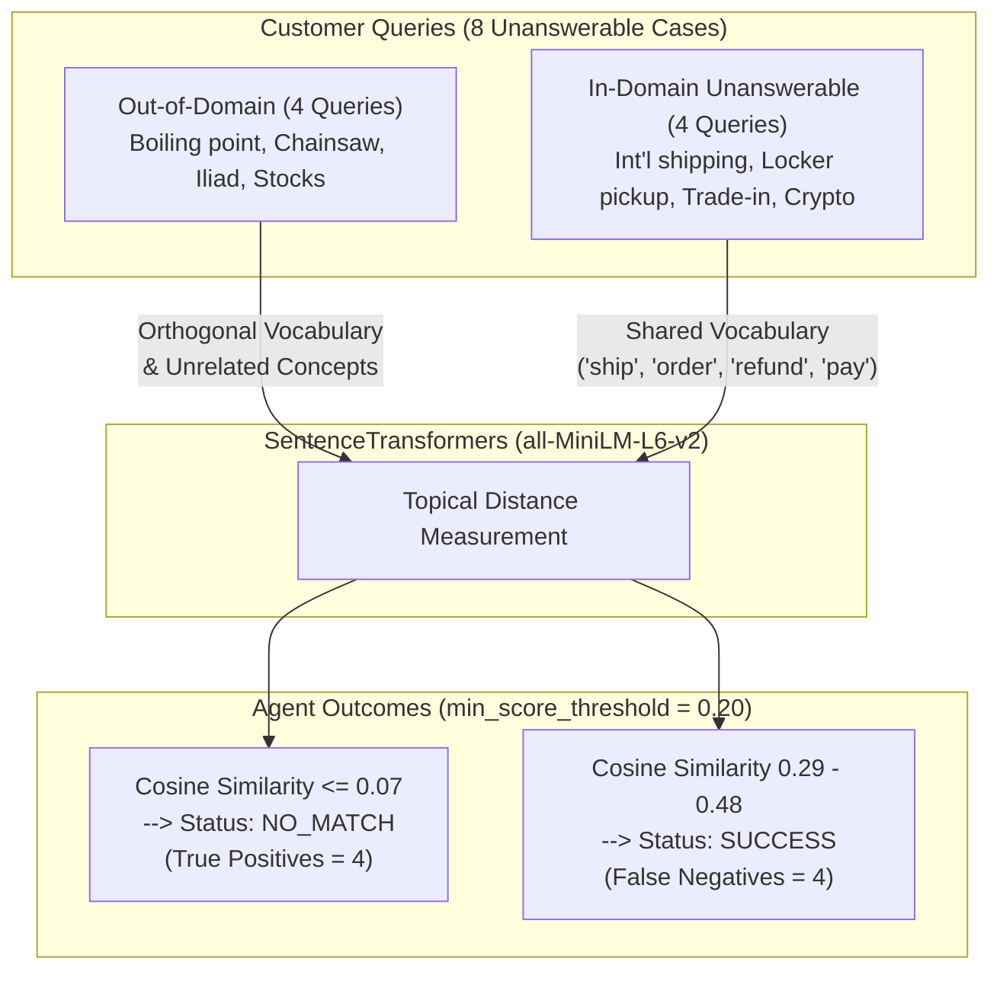

# Knowledge Retrieval Evaluation: Comprehensive Error Analysis & Integration Readiness

> [!IMPORTANT]
> **Repository Context:** NEW repository ONLY (`spoortibiradar8/customer-support-coach` at `c:\Users\Admin\Desktop\customer-support-coach`).
> **Git Status:** Branch `main`, clean working tree, no commits made, zero package installations.
> **Regression Verification:** **89 passed, 0 failed, 1 warning** across all test suites.
> **Production State:** Similarity threshold $0.20$ preserved; live ChromaDB retrieval and contextual query builder untouched.

---

## 1. Executive Summary

A thorough read-only error analysis of the Knowledge Recommendation Agent's Task 6 evaluation results was conducted across the 22-query labeled evaluation benchmark.

The evaluation confirmed:
1. **Flawless retrieval precision on grounded queries (N=14):**
   - **Recall@3:** 100.00% (both document-level and chunk-level)
   - **MRR:** 1.0000 (Target document at Rank 1 for 100% of answerable queries)
   - **NDCG@3:** 1.0000
   - **Source Attribution Accuracy:** 100.00%
2. **Clear division in unanswerable queries (N=8):**
   - **Out-of-Domain (4 queries):** 100% correctly rejected as `NO_MATCH` ($\text{scores} \le 0.07$, well below $0.20$).
   - **In-Domain Unanswerable (4 queries):** 100% accepted as matches ($\text{scores} = 0.29 - 0.48$), resulting in 4 False Negatives ($\text{FN}=4$).
3. **No-Match Confusion Matrix ($y=1$ is Unanswerable):**
   - $\text{TP} = 4$ (Out-of-domain queries rejected)
   - $\text{FP} = 0$ (Zero false rejections of answerable queries)
   - $\text{TN} = 14$ (All answerable queries matched)
   - $\text{FN} = 4$ (In-domain unanswerable queries matched)
   - **Precision:** 100.00%
   - **Recall:** 50.00%
   - **F1:** 66.67%
   - **Accuracy:** 81.82%

---

## 2. Deep-Dive Analysis: The 4 False Negatives vs. 4 True Positives

### 2.1. Individual False Negative Case Studies

#### Case 1: `eval_19` — International Shipping Destination Inquiry
- **Customer Message:** `"Do you ship internationally to Canada, Australia, or the UK?"`
- **Detected Intent:** `Delivery / order`
- **Contextual Query:** `Delivery / order - Do you ship internationally to Canada, Australia, or the UK?`
- **Top Retrieved Document:** `shipping_and_delivery.pdf` (Page 1)
- **Top Chunk ID & Score:** `e11e1dd62150604a_p1_c0` (Score: **0.3370**)
- **Passage Content:** States standard delivery is 3–5 business days, express is 1–2 business days before 2 pm, and remote areas add 3 extra days.
- **Why Accepted:** Score $0.3370 > 0.20$.
- **Does it Support the Query?** **NO.** The passage describes only domestic dispatch timelines; international shipping destinations are never mentioned.
- **Root Cause:**
  1. *Topical Overlap:* The bi-encoder embedding model maps "ship", "delivery", "order" directly to the shipping document.
  2. *Absence of Knowledge:* The sample knowledge base simply lacks an international shipping policy document.

#### Case 2: `eval_20` — Physical Locker & In-Store Pickup
- **Customer Message:** `"Can I pick up my online order at a local retail store or physical locker?"`
- **Detected Intent:** `Delivery / order`
- **Contextual Query:** `Delivery / order - Can I pick up my online order at a local retail store or physical locker?`
- **Top Retrieved Document:** `account_and_password_faq.pdf` (Page 1)
- **Top Chunk ID & Score:** `40127cfe9c0a26e5_p1_c1` (Score: **0.3629**)
- **Passage Content:** `"o unlock it after verifying the customer's name and order number."`
- **Why Accepted:** Score $0.3629 > 0.20$.
- **Does it Support the Query?** **NO.** The passage is a 64-character fragment from account lockout verification; it has nothing to do with order fulfillment.
- **Root Cause:**
  1. *Ingestion Chunk Boundary Artifact:* During PDF ingestion (`chunk_size=500, overlap=50`), page 1 of the FAQ was split such that a 64-character trailing fragment was indexed as its own chunk.
  2. *Lexical Collision:* The query phrase `"online order"` matched `"order number"` in this tiny chunk, producing an inflated cosine similarity of $0.3629$.

#### Case 3: `eval_21` — Electronics Trade-In / Trade-Up Program
- **Customer Message:** `"Do you offer an electronics trade-in or trade-up program for old smartphones?"`
- **Detected Intent:** `Refund / billing`
- **Contextual Query:** `Refund / billing - Do you offer an electronics trade-in or trade-up program for old smartphones?`
- **Top Retrieved Document:** `returns_and_refunds.pdf` (Page 1)
- **Top Chunk ID & Score:** `a2ce9b7bd3c12470_p1_c0` (Score: **0.4760**)
- **Passage Content:** Outlines the 30-day return window for unused items in original packaging, excluding opened software and gift cards.
- **Why Accepted:** Score $0.4760 > 0.20$.
- **Does it Support the Query?** **NO.** The policy covers returning unused purchases for a refund; no trade-in or hardware exchange program exists in the text.
- **Root Cause:**
  1. *Domain Proximity:* Trade-in programs and product return policies occupy adjacent vector clusters in e-commerce semantic embeddings.
  2. *Intent Prefix Reinforcement:* Prepending `"Refund / billing - "` reinforced the returns document association.

#### Case 4: `eval_22` — Cryptocurrency Payment Methods
- **Customer Message:** `"Can I pay for my order using cryptocurrency like Bitcoin or Ethereum?"`
- **Detected Intent:** `Refund / billing`
- **Contextual Query:** `Refund / billing - Can I pay for my order using cryptocurrency like Bitcoin or Ethereum?`
- **Top Retrieved Document:** `shipping_and_delivery.pdf` (Page 2, Chunk `e11e1dd62150604a_p2_c0`, Score: **0.2931**)
- **Second Document:** `returns_and_refunds.pdf` (Chunk `a2ce9b7bd3c12470_p1_c0`, Score: **0.2862**)
- **Passage Content:** Discusses missing parcels/courier redirection, while the refund document discusses refunds back to the original payment method.
- **Why Accepted:** Score $0.2931 > 0.20$.
- **Does it Support the Query?** **NO.** Neither passage states which checkout payment methods are accepted.
- **Root Cause:**
  1. *Semantic Proximity:* "pay for my order" overlaps with order delivery and refund payment methods.
  2. *Knowledge Base Gap:* No document defining checkout/payment options exists in Acme Gadgets' sample files.

---

### 2.2. Contrast: Why True Positives (`eval_15` to `eval_18`) Succeeded

| Query ID | Customer Message | Top Score | Outcome |
|---|---|---|---|
| `eval_15` | "What is the boiling point of water at 3000 meters altitude?" | **0.0729** | `NO_MATCH` ✅ |
| `eval_16` | "How do I tune the carburetor on a chainsaw engine?" | **0.0410** | `NO_MATCH` ✅ |
| `eval_17` | "Who wrote the ancient Greek epic poems the Iliad and the Odyssey?" | **-0.0096** | `NO_MATCH` ✅ |
| `eval_18` | "What is the current stock market price of Apple and Google shares?" | **0.0630** | `NO_MATCH` ✅ |

**Key Finding:** Out-of-domain queries inhabit distant vector regions with virtually zero semantic overlap with customer support policies. Their scores remain strictly below $0.10$. However, in-domain unanswerable queries inhabit the *same topical domain* as the knowledge base. A bi-encoder measures **topical similarity**, not **factual entailment**. A static cosine threshold alone cannot solve this without document expansion or an entailment/cross-encoder model.

---

## 3. Metric Implementation & Integrity Audit

1. **Deduplication:** `compute_recall_at_k` and `compute_precision_at_k` explicitly deduplicate retrieved passages, preventing duplicate chunks or repeated documents from inflating recall.
2. **Strict Cutoff Convention:** `compute_precision_at_k` strictly divides by $K=3$. For single-document targets, maximum precision is $1/3 \approx 33.33\%$.
3. **Contingency Consistency:** Unanswerable is defined as the positive class ($y=1$). Because all 4 positive predictions were true negatives for retrieval, No-Match Precision is $100\%$ and Recall is $50\%$.
4. **Error Separation:** System or database exceptions yield `status = ERROR` and are excluded from `NO_MATCH` classification metrics.

---

## 4. Recommended Improvements (Without Production Changes)

### 4.1. Within Knowledge Recommendation Agent Scope (Agent Refinements)
1. **Confidence Tiering in Response Metadata:**
   - Rather than treating all scores $\ge 0.20$ identically, attach a confidence tier:
     - **High Confidence ($\ge 0.50$):** Verifiably direct or paraphrased match.
     - **Moderate Confidence ($0.35 - 0.50$):** Likely relevant context.
     - **Tentative / Low Confidence ($0.20 - 0.35$):** Topically adjacent, but answer may be missing.
2. **Conditional Intent Prepending:**
   - Prepend detected intent only when the customer query is short ($< 5$ words) or contains pronoun references. For specific questions like `eval_19` (international shipping), the message is already specific; prepending intent only inflated the topic similarity.
3. **Ingestion Fragment Filtering:**
   - Enforce a minimum chunk length of 100 characters in the chunker, eliminating orphan fragments like `40127cfe9c0a26e5_p1_c1` (`"o unlock it after verifying the customer's name and order number."`).

### 4.2. Team-Level Architecture Decisions (Requires Team Agreement)
1. **Cross-Encoder / Entailment Verifier (Coaching Agent & Knowledge Recommendation Teams):**
   - Introduce a fast secondary cross-encoder (e.g. `cross-encoder/ms-marco-MiniLM-L-6-v2`) or LLM verification step before returning passages to ensure the passage answers the query.
2. **Knowledge Base Documentation Expansion (Knowledge Base Engineering / Product):**
   - Add a 1-page `accepted_payments_and_policies.pdf` defining payment methods and international shipping limitations, converting all 4 unanswerable queries into grounded answerable queries.
3. **LLM Coaching Prompt Grounding (Coaching Agent):**
   - Instruct the coaching LLM: *"If the retrieved passages do not explicitly contain the answer, advise the trainee to inform the customer that the policy is currently unavailable or requires supervisor escalation."*

---

## 5. Integration Readiness Guide for Other Team Members

Documentation has been created in:
- [`docs/evaluation_error_analysis.md`](file:///c:/Users/Admin/Desktop/customer-support-coach/docs/evaluation_error_analysis.md)
- [`docs/knowledge_agent_integration_readiness.md`](file:///c:/Users/Admin/Desktop/customer-support-coach/docs/knowledge_agent_integration_readiness.md)

### Integration Checklist:

| Team Role | Key Action | Implementation Details |
|---|---|---|
| **Orchestrator Team** | Call `agent.run(session, message)` | Returns standard `AgentResult`. `AgentResult.result` contains serialized `KnowledgeRecommendationResponse`. Check `result["status"]` for `"success"`, `"no_match"`, or `"error"`. |
| **Streamlit Frontend Team** | Render Knowledge Recommendations | Display top passage text, source filename, and page number in sidebar/card. If `no_match == True`, display *"No relevant policy found."* For scores $< 0.40$, render *"Low confidence match"*. |
| **QA & Testing Team** | Execute regression & benchmarks | Unit tests: `pytest tests/test_evaluation_metrics.py tests/test_knowledge_contract.py tests/test_contextual_query.py tests/test_retrieval_metadata.py` (62 tests, 1s). Live tests: `pytest tests/test_live_rag_integration.py` (7 tests). Benchmark: `python -m backend.evaluation.eval_runner`. |
| **Coaching Agent Team** | Ground LLM generation | Pass retrieved passages into LLM prompt context to ground coaching tips in official store policies. |

---

## 6. Prioritized Next Actions

1. **Immediate (Integration):** Provide `docs/knowledge_agent_integration_readiness.md` to Orchestrator for wiring the Orchestrator workflow.
2. **Milestone 2 Wrap-up:** Coordinate with Streamlit Frontend to ensure the UI gracefully displays `NO_MATCH` and low-confidence indicators.
3. **Milestone 3 Enhancement:** Implement confidence tiering and investigate cross-encoder re-ranking to close the in-domain unanswerable gap.
